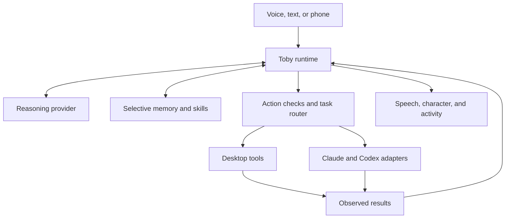

# ✦ TOBY

### Your voice. Your computer. Your companion.

**A desktop AI companion that listens, sees, acts, and learns how you work.**

[Vision](docs/PRODUCT.md) · [Architecture](docs/ARCHITECTURE.md) · [Stack](docs/STACK.md) · [Roadmap](docs/ROADMAP.md) · [Team](docs/HIERARCHY.md)

---

> **“Hey Toby, start regression testing. And while Claude works, tell me where we left off.”**
>
> Toby routes the task to the right session, watches real activity, and speaks an update without interrupting the worker.

## What Toby is

Toby is a proposed voice-first desktop assistant with an animated companion, optional phone access, and practical control over the user's computer. Users speak naturally. Toby understands the request, chooses the right tool or connected AI session, performs authorized actions, verifies the result, and explains what happened.

The desktop is its primary home. A phone is optional. **Toby is a working project name:** each user can name their own assistant and choose its voice and appearance.

Its character has expressive eyes that follow its attention and cursor. Its personality grows through compact, editable memory and verified reusable routines. Conversation remains available while coding agents or desktop tasks are busy.

**This branch contains an original product blueprint, not an installable Toby application.** Capability descriptions below are intended behavior. Stack choices are proposals with explicit validation gates.

## The experience

| Say this | Intended behavior |
| --- | --- |
| “Start regression testing in Claude.” | Route a task to the selected connected session and monitor progress. |
| “Give me an update.” | Summarize observed activity without submitting a new agent prompt. |
| “Install these tools in PowerShell and WSL2.” | Inspect both environments, propose the installation, execute within granted authority, and verify each result. |
| “Draft an email to Alex.” | Resolve the recipient, prepare a draft, and present it for edits or approval before sending. |
| “What is this error on my screen?” | Read the relevant window and explain the visible evidence. |
| “Remember that I prefer short spoken updates.” | Store an explicit preference that the user can inspect, correct, or remove. |
| “Do my usual project setup.” | Select an applicable verified skill, check its assumptions, and perform its steps. |
| “Stop. I’ll take over.” | Stop input actions immediately and yield desktop control. |

## Core principles

| Principle | Meaning |
| --- | --- |
| **Voice is the interface** | Internal transcription leads directly to conversation and action; no copy-and-paste workflow. |
| **Observe before acting** | Use session events, application controls, terminal output, and fresh screenshots as appropriate. |
| **Evidence before confidence** | A task is complete only when its outcome has been checked. |
| **A memory, not a transcript warehouse** | Keep useful facts and task summaries; retrieve only what is relevant. |
| **Your companion, your identity** | Name, voice, appearance, and interaction preferences belong to the user. |
| **Provider choice** | Separate Toby's reasoning backend from the Claude/Codex sessions it operates. |
| **Visible control** | Show listening, capture, action target, waiting, and user takeover clearly. |
| **Original execution** | Build new code and visual assets independently of the inspirational project. |

## How the pieces connect

## Proposed stack at a glance

| Layer | Proposed direction |
| --- | --- |
| Desktop interface | Tauri 2, React, TypeScript |
| Local host | Rust with explicit command boundaries |
| Windows observation and input | Windows Graphics Capture, UI Automation, Win32 input APIs |
| Local speech | Whisper.cpp recognition; speech playback engine selected after latency and license review |
| Reasoning | Supported provider adapters; optional local vision/tool model after evaluation |
| Coding sessions | Codex app-server; supported Claude Code integration; managed terminal fallback |
| Memory | SQLite, full-text search, versioned skill documents |
| Phone companion | React Native candidate; desktop remains the execution authority |
| Verification | Focused module tests, integration fixtures, representative desktop tasks |

Read [STACK.md](docs/STACK.md) for tradeoffs and [INTEGRATIONS.md](docs/INTEGRATIONS.md) for provider eligibility and session limitations.

## Build in useful increments

| Milestone | Visible result |
| --- | --- |
| **01 · Prove the foundations** | Validate Windows capture, speech latency, provider access, and one agent connection. |
| **02 · Conversation** | Speak to an original desktop companion and interrupt its replies. |
| **03 · Agent direction** | Start work, inspect progress, and route corrections to one managed session. |
| **04 · Desktop operation** | Complete a small set of verified click/type/terminal tasks and yield to the user. |
| **05 · Memory and skills** | Remember scoped preferences and reuse tested routines. |
| **06 · Multiple sessions** | Route requests among projects, providers, and Windows/WSL environments. |
| **07 · Phone and beta** | Pair an optional phone, reconnect safely, and package a Windows pilot. |

Milestones are gated by evidence, not dates. See the [delivery plan](docs/ROADMAP.md).

## Blueprint library

| Document | Purpose |
| --- | --- |
| [Product](docs/PRODUCT.md) | Detailed experience, scope, users, and success criteria |
| [Architecture](docs/ARCHITECTURE.md) | Runtime layers, task state, concurrency, observation, and execution |
| [Technology stack](docs/STACK.md) | Recommended components, alternatives, and validation requirements |
| [Integrations](docs/INTEGRATIONS.md) | Claude, Codex, OAuth, terminal ownership, and cost model |
| [Memory and skills](docs/MEMORY_AND_SKILLS.md) | Selective learning, retention, correction, and skill verification |
| [Companion and interface](docs/COMPANION_AND_UX.md) | Original character, gaze, cursor, settings, and phone experience |
| [Team hierarchy](docs/HIERARCHY.md) | Chief, Validator, specialist roles, ownership, and handoffs |
| [Delivery roadmap](docs/ROADMAP.md) | Dependencies, milestones, acceptance tests, and release gates |
| [Repository plan](docs/REPOSITORY_PLAN.md) | Future folders, worktrees, branch strategy, and atomic changes |
| [Decisions](docs/DECISIONS.md) | Settled direction, proposals, open questions, and risks |
| [Provenance](docs/PROVENANCE.md) | Inspiration, fork history, original work, and asset boundaries |
| [Sources](docs/SOURCES.md) | Primary documentation and revalidation notes |

## Project status and provenance

The initial repository was forked from [Bluey by Riley](https://github.com/rbrown101010/bluey-by-riley). That project inspired the broad interaction concept. Its source declares **The Unlicense**.

This blueprint branch has a fresh documentation-only tree. It contains none of the inherited implementation, fonts, images, or GIFs. The inherited files remain in the original branch and Git history; a fork still retains its upstream relationship. No production independence claim is made about the repository's history.

A future implementation should follow this original specification and use newly authored code and visuals. Repository name target: **toby-desktop**, subject to completion of the GitHub rename.

**Speak naturally. Stay in control. Keep moving.**

