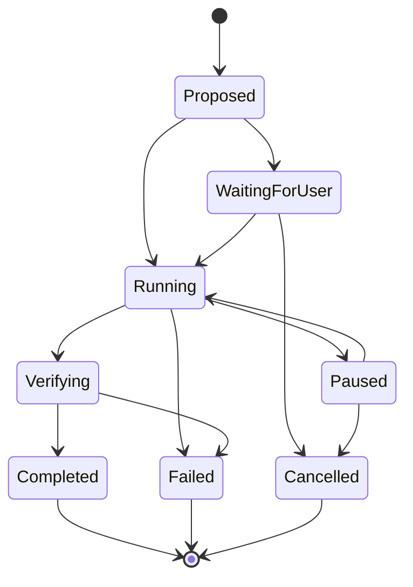

# Runtime architecture

## Design approach

Use a modular desktop application with a local authoritative runtime. Avoid independent network services for each subsystem in the first release. Separation comes from explicit contracts and process boundaries where needed, not a large microservice platform.

The UI displays state and submits user requests. The native runtime owns credentials, persistent memory, tool execution, task state, and the desktop control lease. Provider responses are proposals and explanations; they cannot directly bypass the executor.

## Component hierarchy

| Layer | Responsibility | Must not own |
| --- | --- | --- |
| Presentation | Settings, conversation, companion, activity, approvals | Provider secrets or unrestricted shell execution |
| Speech pipeline | Audio capture, wake phrase, endpoint detection, recognition, playback | Long-term transcript retention |
| Conversation coordinator | Intent, conversational context, routing, explanation | Low-level global input injection |
| Reasoning adapter | Model requests, streaming, structured action proposals | Independent permission expansion |
| Task runtime | Durable states, cancellation, retries, operation IDs | Inferring completion from silence |
| Observation broker | Screen, app controls, terminal output, worker events | Treating observed text as authority |
| Execution broker | Authorized calls, focus checks, control lease, verification | Inventing missing targets |
| Memory and skills | Scoped facts, summaries, retrieval, versioned procedures | Automatically trusting unverified routines |
| Agent adapters | Provider/session lifecycle and normalized events | Universal attachment assumptions |
| Phone gateway | Pairing, authenticated requests, freshness checks | A separate task truth or parallel desktop authority |

## Request lifecycle

A spoken utterance becomes an ephemeral recognized utterance. The coordinator resolves intent, target, and relevant memory. Read-only status requests can return from the task/event store. New actions create a task record and require an appropriate execution plan.

The runtime checks scope, capabilities, current state, and any required user review. An action is executed, its outcome observed, and the task record updated. Only then can Toby claim success. A concise response is spoken and a detailed activity entry is retained according to the selected policy.

## Task states

A parent task can also end as partially completed when subtasks differ. Connectivity and worker liveness are separate fields: a disconnected observer does not prove a stopped worker. Every event carries task ID, session ID where applicable, source, timestamp, and sequence information.

## Concurrency and control

Conversation, speech playback, observation, and coding workers can run concurrently. Foreground computer operation has one active lease per desktop. A mouse-driving task must not compete with another mouse-driving task.

Physical user input revokes or pauses the lease. Programmatically injected input needs attribution so Toby does not mistake its own events for takeover. A global stop shortcut and an always-visible pause control work independently of a cloud model response.

Parallel terminal jobs are possible only with distinct processes and environments. Two jobs modifying the same project need a declared coordination rule. A display overlay cursor can represent intent, but it is not an independent OS pointer. Real clicks still require a coherent input/focus strategy.

## Observation

Prefer structured worker events for coding sessions, text output for terminals, application accessibility controls for native windows, and DOM structure for supported browser workflows. Screenshots supply visual context when these are insufficient.

Each visual observation includes timestamp, target window, display identity, geometry, scale factor, and capture generation. Coordinate actions bind to that observation. Changes to focus, target geometry, monitor scale, or capture age can invalidate a planned click and require another observation.

Capture cadence is adaptive. Read after significant UI changes and around actions; increase observation during dragging or animation when necessary. Smooth character animation does not require continuous model video inference.

Exclude the companion overlay from captures when technically possible. Check for feedback effects when it cannot be excluded. Multiple monitors, negative desktop coordinates, DPI scaling, and window movement belong in the prototype test matrix.

## Execution and verification

Tool contracts declare required capability, target, input schema, expected observation, timeout, and cancellation behavior. Terminal execution records exit code and meaningful output, but successful exit alone may not establish the intended result.

Never retry a non-idempotent action blindly. Before retrying a send, submission, installation, or file mutation, inspect whether it already happened. Operation IDs reduce duplicates in Toby's own system; they cannot guarantee an external application offers exactly-once execution.

## Local persistence and recovery

SQLite stores tasks, normalized events, memory records, settings, and skill metadata. Large raw logs or optional diagnostic media use bounded separate storage. OS credential facilities hold tokens and keys; database records contain references, not secret values.

On restart, reload task checkpoints and reconnect where supported. An interrupted task becomes uncertain or paused until checked. Pending actions are not silently replayed. Optional diagnostics redact secrets and record capture provenance.

## Phone boundary

The phone is a remote conversation and review surface. Commands enter the same desktop runtime. Pairing identifies a device and grants explicit capabilities; authentication is not an automatic grant of all computer control.

Start with LAN connectivity. Use encrypted authenticated transport, expiring challenges, revoked-device rejection, and request IDs. Remote access requires a separate decision on relay operation, costs, NAT traversal, and security review. Do not expose an unauthenticated desktop control port.

## Architectural proof required

Before implementation expands, prove local speech interruption, Windows capture/input, a supported provider route, Codex or Claude session events, and a reliable stop path. The proof should use a single vertical slice rather than scaffold every future component.
