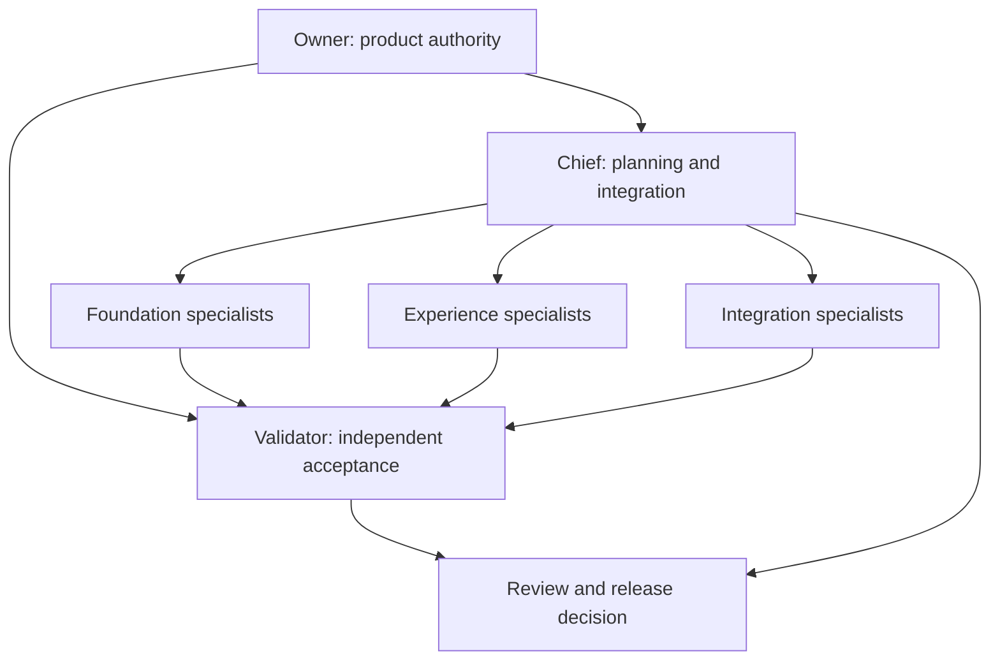

# Development hierarchy and ownership

## Purpose

This describes the proposed human/AI development team for implementing Toby. It is not evidence that agents are currently running, and it is separate from Toby's runtime architecture. The number of specialists grows with approved scope; it should not become a fixed swarm working without coordination.

The owner approves product direction and meaningful scope changes. The Chief coordinates planning and integration. The Validator independently checks outcomes and can block promotion. Specialists own bounded components.

## Decision hierarchy

## Role matrix

| Role | Owns | Typical output | Boundary |
| --- | --- | --- | --- |
| Owner | Product scope, experience, final approval | Approved milestones and decisions | Must not be given vague implementation approvals |
| Chief | Plan, architecture, decomposition, dependencies, integration | Work packets, contract decisions, integrated milestone | Cannot self-certify independent validation |
| Validator | Acceptance evidence, regression review, release gates | Pass/block report with reproducible findings | Does not silently rewrite the feature under review |
| Runtime specialist | Task states, cancellation, execution broker | Runtime contract and implementation | No uncontrolled provider-specific behavior |
| Windows specialist | Capture, UIA, input, geometry, takeover | Native observation/action adapter | Does not own conversational policy |
| Voice specialist | Recognition, VAD, wake phrase, playback | Latency-tested speech pipeline | No permanent audio archive by default |
| Agent integration specialist | Codex/Claude adapters and session registry | Event normalization and routing | No undocumented token extraction |
| Memory specialist | Records, retrieval, forgetting, skill lifecycle | Scoped memory and verified routines | No automatic permission expansion |
| Experience specialist | Settings, conversation, activity, accessibility | Usable desktop surfaces | No unrestricted tool execution from UI |
| Motion specialist | Original character, gaze, animation | New asset set and state mapping | No inherited asset reuse |
| Mobile specialist | Pairing, phone interaction, reconnect | Optional remote client | Desktop remains task authority |
| Release specialist | Packaging, dependency review, update/recovery | Reproducible installer and release evidence | No unsupported performance claims |

One implementer can wear several specialist hats. Chief and Validator responsibilities remain distinct even when the team is small. Add a specialist only when its ownership and dependencies are clear.

## Planning before implementation

For a new milestone, Chief presents the goal, user-facing behavior, constraints, affected contracts, repository paths, dependencies, acceptance scenarios, and risks. Owner approval establishes that milestone's scope. Routine decisions inside that scope proceed without repeated approval; meaningful scope changes return for review.

Chief assigns bounded work packets only after contracts are settled enough to reduce conflicting edits. Work packets declare allowed paths, shared-contract dependencies, branch/worktree, validation method, and handoff evidence.

## Work packet template

| Field | Required content |
| --- | --- |
| Goal | Concrete behavior and motivating scenario |
| Scope | Included and excluded changes |
| Ownership | Paths and contracts this worker may modify |
| Dependency | Prerequisite commit or contract version |
| Authority | Approved milestone and action boundaries |
| Verification | Meaningful scenarios and failure cases |
| Deliverable | Atomic commit plus explanation/evidence |
| Escalation | Unresolved decisions that affect another owner |

## Handoff and validation

The specialist completes a coherent change, runs appropriate focused checks, and provides a handoff. Chief reviews fit and cross-component impact. Validator checks representative behavior and the evidence independently, including relevant failure cases.

A validator report identifies the commit evaluated, environment, scenarios, results, and remaining limitations. It must not say “passed” simply because the code looks plausible or the implementer claimed success.

Failed validation returns a specific bounded repair task. New changes invalidate evidence only for affected behavior; do not rerun unrelated suites endlessly. Integration/release checks run after the combined milestone changes are assembled.

## Model selection

Chief and Validator use a capable reasoning model with high reasoning where supported. Specialists use a lower-cost capable model by default and escalate when task complexity warrants it. Model identifiers and reasoning levels are discovered from the user's installed tools and account rather than assumed.

The owner's desired Claude/Codex model preferences can be stored as configuration candidates. Unavailable model names are reported rather than silently substituted. Choosing a different model does not weaken the validation gate.

## Worktrees and commits

Give each implementation specialist an isolated branch and worktree. Assign one owner for shared schemas. Avoid two workers editing the same central file without coordination.

Commit a focused behavior change with its directly relevant tests/docs. Push feature branches as reviewable checkpoints when authorized. Promotion to the integration branch requires Chief and Validator acceptance. Merge to the release/default branch follows the owner's approved release policy.

No automatic merge, release, or privileged permission bypass is established by this documentation task.

## Staffing by milestone

| Milestone | Suggested active responsibilities |
| --- | --- |
| Foundations | Chief, Validator, Windows, Voice, Integrations |
| Conversation | Chief, Validator, Voice, Experience, Runtime |
| Agent direction | Chief, Validator, Integrations, Runtime |
| Desktop action | Chief, Validator, Windows, Runtime, Experience |
| Memory/skills | Chief, Validator, Memory, Runtime |
| Phone | Chief, Validator, Mobile, Runtime, Experience |
| Beta | Chief, Validator, Release plus owners of failing checks |

These are responsibilities, not a requirement to run every role concurrently. The practical limit is the number of independent work packets and review capacity.
