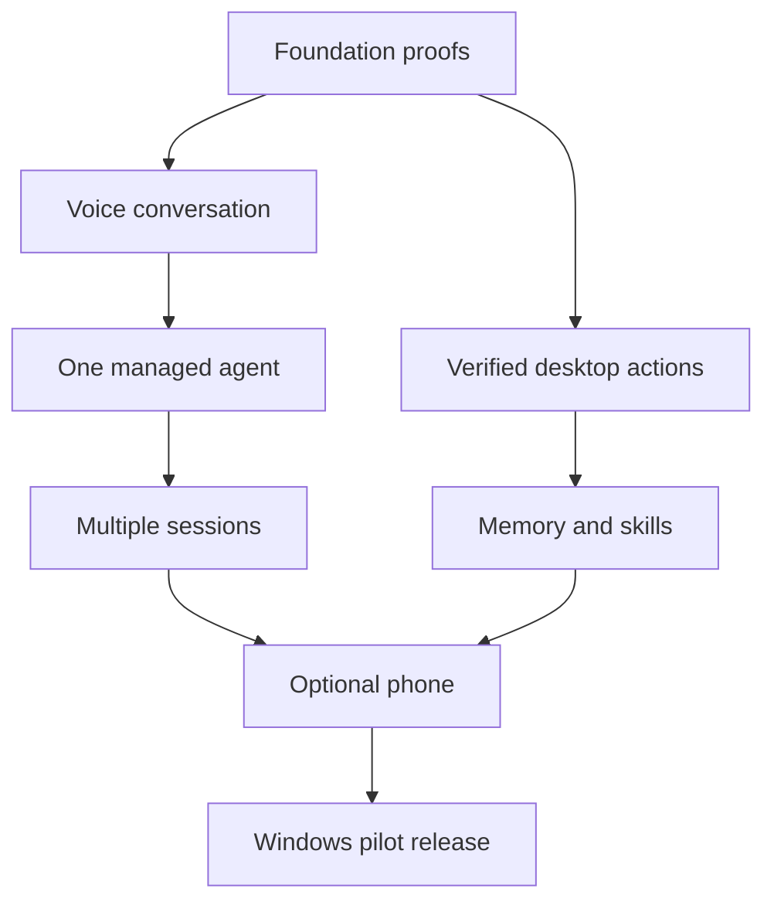

# Delivery roadmap

## Execution policy

Build a small end-to-end experience before expanding the system. This branch is the planning deliverable. It contains no implementation and no fabricated execution evidence.

The first implementation begins only after the owner accepts a milestone plan. A milestone is complete when its acceptance scenarios pass on a recorded environment, not when its folders or screens exist.

## Dependencies

Memory preferences can be prototyped earlier, but trusted procedural skills depend on verified execution. Phone work waits until the desktop runtime has stable task and authority contracts.

## Milestone 0: Foundation proofs

**Outcome:** replace the largest assumptions with measurements.

| Work | Evidence required |
| --- | --- |
| Desktop shell spike | Tray, overlay, settings window, global stop shortcut, clean shutdown |
| Windows capture/input spike | Observe and operate a test application on single and mixed-DPI monitors |
| Local speech spike | Recognition/playback latency, technical vocabulary, noise, interruption |
| Provider spike | Valid supported authentication and a model request with required capability |
| Coding session spike | One task with correlated events, completion, interruption, reconnect limits |
| Dependency review | Engine/model/voice license and distribution plan |

Use a bounded disposable test app and known tasks. Select one host stack after the spike. If a choice fails, record the evidence and change the proposal before broad implementation.

**Gate:** at least one viable route for speech, reasoning, observation, execution, and agent state. Document unresolved limits rather than hiding them behind mocks.

## Milestone 1: Desktop conversation and original companion

**Outcome:** user speaks to a named desktop companion and receives interruptible replies.

Build push-to-talk, local recognition, a supported reasoning adapter, local playback, conversation text, settings, and original placeholder animation. Add clear listening/thinking/speaking states. Keep persistent memory limited to user-selected identity and settings.

Test normal speech, silence, interrupted speech, mistaken recognition, device removal, provider outage, and playback interruption. Preserve typed input when audio fails.

**Gate:** usable conversational loop on a CPU-capable reference machine; no copy-and-paste step; text remains accessible; stop speech works locally.

## Milestone 2: One managed coding session

**Outcome:** Toby can start work and explain observed progress without disturbing it.

Implement a session registry, one supported adapter, normalized events, task state, project mapping, and named target display. Begin with Codex app-server or another integration proven in Milestone 0, not multiple partially working providers.

Scenarios: start a test task; ask for status; ask again; correct the task; observe a user-input request; cancel; reconnect after observer loss.

**Gate:** status requests create zero additional worker turns; a new task dispatch is correlated once; unknown liveness is reported honestly; target session is visible.

## Milestone 3: Verified desktop and terminal actions

**Outcome:** Toby completes a narrow set of computer tasks while yielding to physical user input.

Implement observation snapshots, target resolution, execution broker, foreground lease, coordinate freshness, stop controls, and verified outcomes. Include open application, locate a control, type text, scroll, and a simple managed terminal operation.

Use a staged email-like test workflow for draft/edit/approval behavior before live email. Installation workflows must use official sources and check Windows/WSL outcomes independently.

**Gate:** representative actions succeed on recorded configurations; geometry/focus changes trigger reobservation; human takeover stops pending input; duplicate retry does not produce repeated submission.

## Milestone 4: Selective memory and verified skills

**Outcome:** restarting Toby preserves useful context without retaining every transcript.

Implement scoped facts, provenance, confidence, correction, duplicate merging, retrieval budgets, export/forget controls, completed-task summaries, and declarative skill documents.

Scenarios include a global preference, project-only override, stale path, corrected preference, deleted fact, failed routine, successful routine candidate, verified skill, and changed prerequisite.

**Gate:** explicit corrections dominate inferred behavior; unrelated project context is excluded; failed routines never become trusted; deletion removes active retrieval entries and derived indexes.

## Milestone 5: Multiple sessions and environments

**Outcome:** route requests among several Claude/Codex projects and Windows/WSL jobs.

Add additional proven adapters, capability levels for existing terminals, per-project defaults, independent worker tasks, and structured environment records. The desktop action lease stays singular.

Test similarly named sessions, unavailable provider, occupied terminal, concurrent workers, project switching, and an ambiguous “tell it” reference.

**Gate:** no silent cross-project routing; unsupported attachment is labeled; only one foreground input owner; observing one worker does not alter another.

## Milestone 6: Optional phone companion

**Outcome:** a paired phone can speak, inspect status, stop work, and review actions.

Start with LAN-only pairing, explicit desktop availability, encrypted authenticated communication, revocation, request IDs, and state resynchronization. Reuse desktop-owned provider connections and memory. Keep remote/cloud relay out until its operating model is accepted.

Test phone suspend, Wi-Fi changes, desktop sleep, expired review, lost acknowledgement, duplicate request, and revoked device.

**Gate:** old approvals cannot execute changed drafts; reconnect does not replay completed actions; desktop remains the single authority; unavailable is never shown as completed.

## Milestone 7: Windows pilot and release readiness

**Outcome:** install, operate, update, and remove a reliable pilot build.

Package a signed release where available, document prerequisites and model downloads, review dependency/asset provenance, measure resources, and test restart/update/uninstall behavior. Confirm logging and memory defaults match the UI.

Collect pilot feedback across representative microphones, monitors, and Windows environments. Expand supported workflows from evidence.

**Gate:** reproducible release artifact; validated startup and stop behavior; documented compatibility matrix; measured task results; no unreviewed inherited assets; rollback/recovery strategy.

## Schedule assumptions

This is a substantial product, not a weekend feature. A small experienced team might use the following planning ranges, revised after Milestone 0:

| Stage | Rough planning range |
| --- | --- |
| Foundation proofs | 1–2 weeks |
| Conversation and companion | 2–3 weeks |
| One managed agent | 2–3 weeks |
| Desktop operation | 3–5 weeks |
| Memory and skills | 2–4 weeks |
| Multiple sessions | 2–4 weeks |
| Phone | 3–5 weeks |
| Pilot hardening | 3–6 weeks |

These are estimates, not commitments; summing them suggests roughly 18–32 weeks if executed largely sequentially. A solo developer learning the native stack can take substantially longer. Defer phone and broad app coverage to obtain an earlier desktop pilot.

## Proposed measured targets

| Metric | Pilot target to validate |
| --- | --- |
| UI listening feedback | Within 150 ms of local activation |
| Stop/takeover response | Pending input halted within 250 ms under normal desktop conditions |
| Local status update | Begin response within 2 seconds when fresh evidence is available |
| First spoken cloud answer | Aim for 3 seconds after utterance end; report measured variance |
| Known-workflow success | At least 90% over a recorded 30-run initial set |
| Misrouted/duplicate task dispatch | Zero in the acceptance suite |
| Idle resource usage | Measure on reference hardware before assigning a release budget |

Targets are aspirations, not measured results. Voice quality, cloud latency, and general desktop reliability require broader pilot testing than these acceptance samples.

## Completion evidence

Each milestone records commit, environment, actual scenarios, outcome, failures, and limitations. A pass cannot be inferred from a checklist with empty evidence. Testing focuses on behavior and meaningful failure modes rather than duplicating implementation details.
